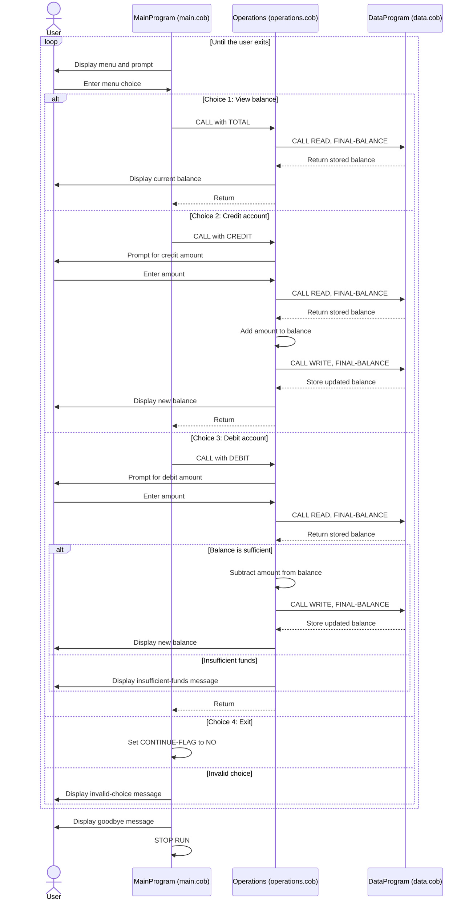

# COBOL Account Management Program

This directory documents the COBOL account-management example in `src/cobol`. The program provides a command-line menu for viewing and changing a balance.

## Source Files

### `main.cob` - Menu and program entry point

`MainProgram` displays the menu, accepts a one-digit choice, and dispatches the requested action to `Operations`:

- `1` passes `TOTAL ` to display the balance.
- `2` passes `CREDIT` to add funds.
- `3` passes `DEBIT ` to subtract funds.
- `4` exits the menu loop.

Other numeric choices display an invalid-choice message. After the user exits, the program displays a goodbye message and stops.

### `operations.cob` - Account operations

`Operations` receives an operation code through its linkage section and handles the corresponding action:

- `TOTAL ` asks `DataProgram` to read the balance, then displays it.
- `CREDIT` accepts an amount, reads the balance, adds the amount, writes the new balance, and displays it.
- `DEBIT ` accepts an amount and reads the balance. It subtracts and saves the amount when sufficient funds are available; otherwise, it displays an insufficient-funds message.

The amount and balance fields use `PIC 9(6)V99`, which represents up to six whole-number digits and two decimal places, with the decimal point implied.

### `data.cob` - Balance storage

`DataProgram` provides the balance data interface. It receives an operation and a balance parameter:

- `READ` copies its stored balance into the caller's balance field.
- `WRITE` copies the caller's balance into its stored balance.

The stored balance is initialized to `1000.00`. This program does not load or save the balance to a file or database.

## Business Rules and Scope

- The example manages one balance, initialized to `1000.00`.
- A debit is permitted only when the current balance is greater than or equal to the debit amount. An insufficient-funds debit does not update the stored balance.
- A credit is added to the balance. The source does not explicitly reject zero or negative credit amounts.
- The source does not explicitly validate that entered amounts are positive or that input is well-formed.
- Despite the student-account context of the exercise, the code contains no student identifiers, multiple student records, tuition or fee rules, or student-specific authorization. Those policies are not implemented here.

## Sequence Diagram

